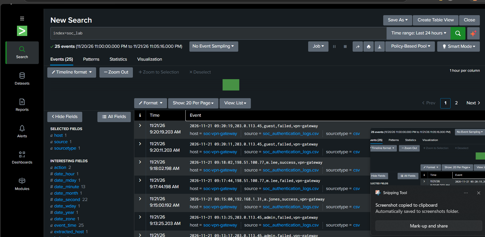
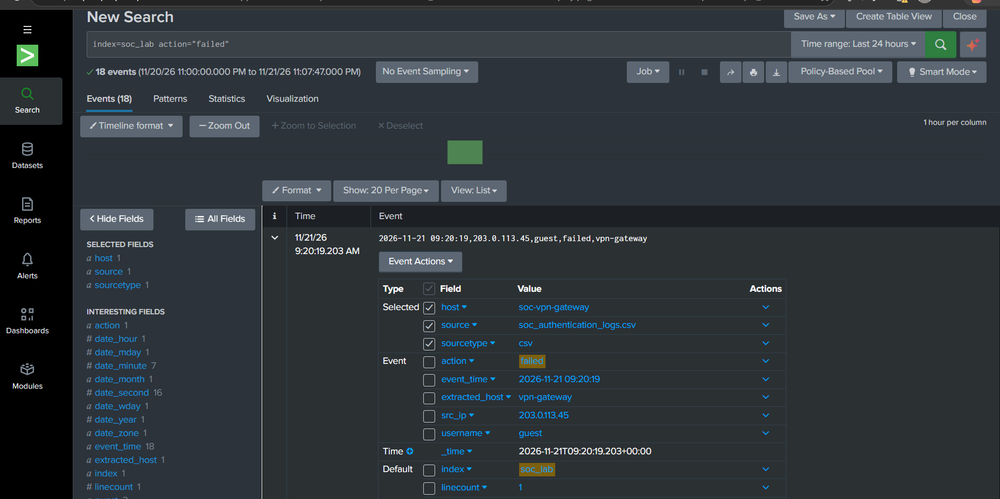
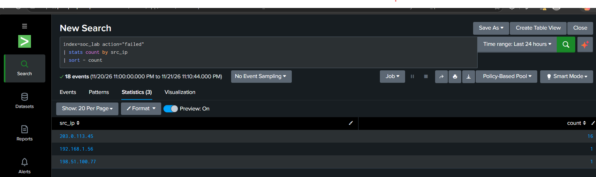
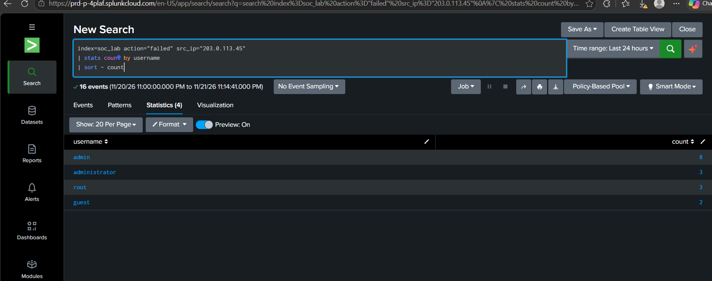
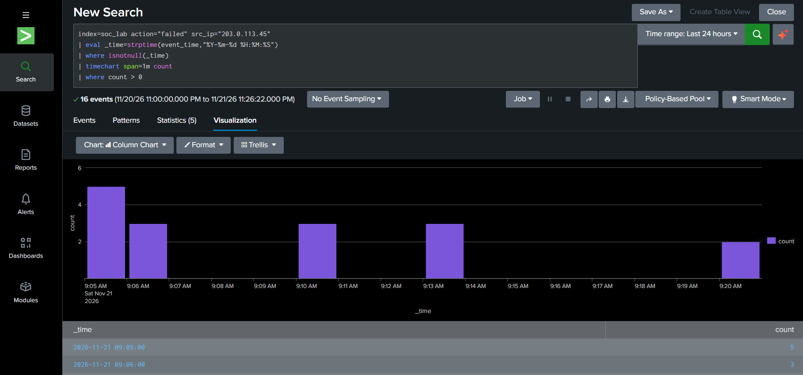
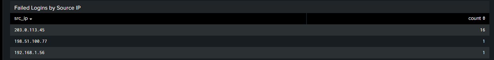
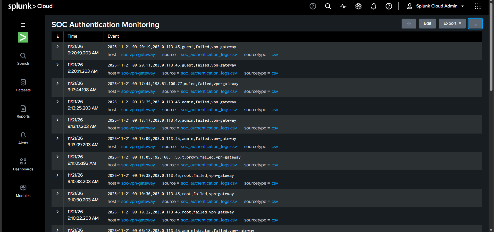

# Splunk SOC Investigation – Brute-Force Detection

## Project Overview

This project demonstrates a practical Security Operations Centre (SOC) investigation using Splunk Cloud Platform.

The aim was to analyse authentication logs, identify suspicious login activity and investigate a potential brute-force attack.

The investigation used a synthetic dataset containing 25 authentication events.

## Objectives

- Ingest authentication logs into Splunk Cloud.
- Search and analyse security events using SPL.
- Identify repeated failed login attempts.
- Investigate suspicious source IP addresses.
- Identify targeted user accounts.
- Analyse login activity over time.
- Create a security monitoring dashboard.

## Tools and Technologies

- Splunk Cloud Platform
- SPL (Search Processing Language)
- CSV authentication logs
- Windows

## Investigation Findings

The investigation identified:

- 25 total authentication events.
- 18 failed login attempts.
- 7 successful login attempts.
- One suspicious source IP address responsible for 16 failed login attempts.
- Four targeted usernames: admin, administrator, root and guest.

The activity was consistent with potential automated password guessing.

## Project Structure

- `data/` – Synthetic authentication log dataset.
- `docs/` – Incident investigation report.
- `screenshots/` – Evidence of searches, findings and dashboard.
- `spl/` – SPL queries used during the investigation.

## Skills Demonstrated

- SIEM monitoring and log analysis.
- SPL searching and filtering.
- Authentication event investigation.
- Suspicious IP identification.
- Brute-force detection concepts.
- Security dashboard creation.
- Technical documentation.

## Investigation Screenshots

### Data Ingestion

### Failed Login Investigation

### Suspicious IP Analysis

### Targeted Accounts

### Login Attack Timeline

### Failed Logins by Source IP

### SOC Monitoring Dashboard

## Disclaimer

This project uses synthetic authentication logs created for educational purposes. No real attacks or unauthorised access took place.

## Learning Outcomes

This project provided practical experience using Splunk Cloud to investigate authentication events, analyse suspicious login patterns and document security findings in a SOC-style workflow.
